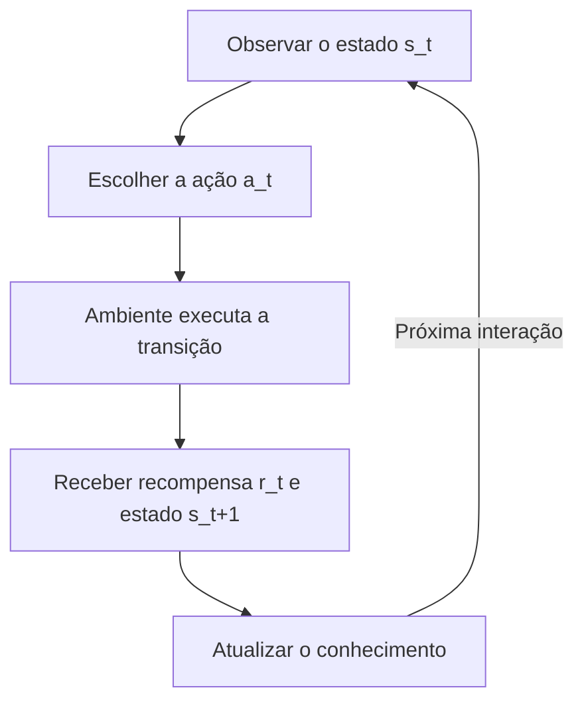

Em **Os 5 Pilares do RL**, você identificou Agente, Ambiente, Estado, Ação e Recompensa. Agora essas peças deixam de ser uma fotografia e passam a funcionar como um processo no tempo.

O Aprendizado por Reforço acontece por meio de um **ciclo contínuo de interação**. O agente observa, decide e age. O ambiente reage e devolve informação. Então o agente usa essa experiência para melhorar decisões futuras.

---

### 🔄 Uma volta, cinco responsabilidades

A cada instante discreto $t$, o ciclo percorre cinco responsabilidades em ordem:

#### 1. Observar o estado ($s_t$)

O agente recebe a informação disponível antes de agir. Para Bibi, o estado inclui sua posição na sala e o nível de bateria. O subscrito $t$ indica que essa é a situação no instante atual.

#### 2. Escolher uma ação ($a_t$)

Uma **política**, representada por $pi$, define como o agente escolhe ações em cada estado. A ação é fixada antes de o ambiente mudar. Isso permite distinguir com clareza a decisão do agente da reação do mundo.

#### 3. O ambiente reage

Depois que recebe $a_t$, o ambiente aplica suas regras de transição. Paredes bloqueiam movimento, passos consomem bateria e a base permite recarga. O agente não escolhe o resultado diretamente.

#### 4. Receber o feedback ($r_t$, $s_{t+1}$)

O ambiente devolve dois sinais:

- **Recompensa $r_t$:** avaliação numérica imediata da transição.
- **Próximo estado $s_{t+1}$:** a nova situação depois da ação.

Uma recompensa informa o que aconteceu naquela transição. Ela não é, sozinha, uma instrução pronta dizendo qual será a próxima ação.

#### 5. Atualizar o conhecimento

Agora existe uma amostra completa da interação. Um algoritmo de aprendizagem pode usar essa amostra para ajustar valores, uma política ou parâmetros internos. A forma exata dessa atualização depende do método. Na Fase 2, você construirá esse mecanismo com **Q-Learning**.

---

### 🧠 A unidade de experiência

Os quatro sinais essenciais de uma transição formam a quádrupla:

$$\text{Experiência} = (s_t, a_t, r_t, s_{t+1})$$

Ela responde a quatro perguntas objetivas:

1. Onde o agente estava?
2. O que ele fez?
3. Qual feedback recebeu?
4. Onde terminou?

Separar esses campos evita uma confusão comum: a ação pertence ao agente, enquanto a recompensa e o próximo estado são produzidos pelo ambiente.

---

### ⌛ Interação, trajetória e episódio

Uma quádrupla representa **uma interação**. Várias interações em sequência formam uma **trajetória**. Quando essa trajetória alcança uma condição terminal, temos um **episódio** completo.

- Em uma partida de xadrez, o episódio termina em xeque-mate, empate ou desistência.
- Para Bibi, o episódio termina quando ele recarrega a bateria ou quando a energia se esgota.

O termo "loop infinito" descreve o processo de treinamento: um episódio termina, outro começa e novas experiências continuam alimentando o aprendizado.

---

### 🧪 Oficina prática: construa o loop

No painel interativo à direita:

1. Escolha uma hipótese de ação ou deixe a política demonstrativa decidir.
2. Use **Avançar uma etapa** para separar observação, decisão, reação, feedback e atualização.
3. Observe quando cada campo de $(s_t, a_t, r_t, s_{t+1})$ se torna conhecido.
4. Compare experiências recentes e identifique o encerramento de um episódio.
5. Ative **Executar sozinho** somente depois de entender o modo passo a passo.

> O simulador demonstra a interface agente-ambiente e o registro de experiências. Ele não finge executar Q-Learning antes de esse algoritmo ser apresentado.

---

### 💡 O que levar desta lição

- O agente controla a escolha de $a_t$; o ambiente controla $r_t$ e $s_{t+1}$.
- Cada volta produz uma experiência $(s_t, a_t, r_t, s_{t+1})$.
- Uma sequência de interações forma uma trajetória; uma trajetória até um estado terminal forma um episódio.
- Aprender significa usar experiências para alterar decisões futuras, não apenas repetir animações.

Na próxima lição, você enfrentará uma escolha central em RL: experimentar uma ação desconhecida ou explorar o que já parece funcionar?

<!-- audio-skip-start -->
### 📚 Referências Científicas & Leituras Recomendadas

* **Sutton, R. S., & Barto, A. G. (2018):** *Reinforcement Learning: An Introduction* (2ª ed., seções 3.1 a 3.3). MIT Press.
* **Watkins, C. J. C. H. (1989):** *Learning from Delayed Rewards*. Tese de Doutorado, King's College, Cambridge.
<!-- audio-skip-end -->
